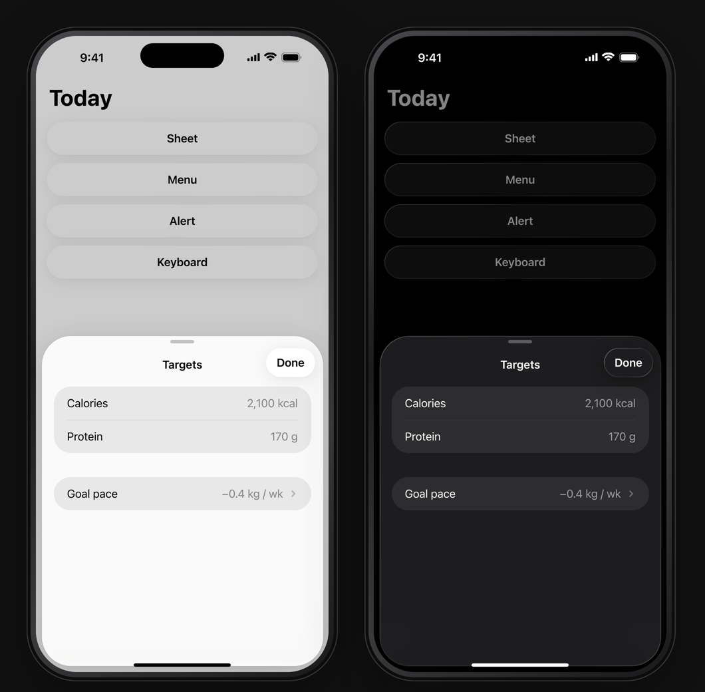
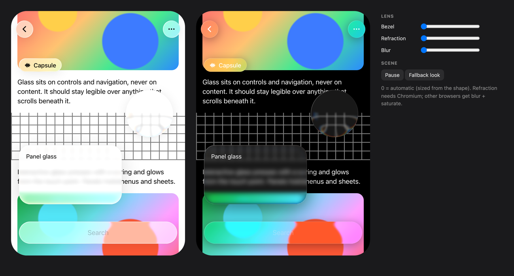

# ios-kit

iOS 26 in the browser, for prototyping native app UI before building it in SwiftUI: a phone frame, Liquid Glass, sheets, menus, alerts and the keyboard. A plain ES module with light-DOM custom elements and no build step. 1 CSS px = 1 pt; the phone is an iPhone 17 Pro Max (440 × 956 pt).

```sh
./tools/link-fonts.sh               # once: serves this Mac's SF Mono (Chromium won't map ui-monospace)
python3 -m http.server 4791         # then open http://127.0.0.1:4791/
```

| Page | What it is |
| --- | --- |
| `index.html` | Gallery: the system pieces in light and dark (`?open=sheet\|menu\|alert\|keyboard` opens one) |
| `glass.html` | Liquid Glass lab: every glass shape over moving content, with lens controls (`?still=<px>` freezes the scroll) |





It's the generic half of the kit behind the OpenCode iOS prototypes. App-specific screens live in each app's own kit file, built from these pieces. The option rail and pick panel for comparing designs is a separate project, prototype-viewer.

## Use

```html
<!doctype html>
<link rel="stylesheet" href="ios-kit/ios-kit.css">
<script type="module" src="ios-kit/ios-kit.js"></script>

<ios-phone theme="dark">
  <div class="screen">
    <ios-glass shape="capsule" interactive>Start</ios-glass>
  </div>
</ios-phone>

<script type="module">
  import IOS from './ios-kit/ios-kit.js'
  const host = document.querySelector('ios-phone').screen
  IOS.sheet(host, { title: 'Targets', body: IOS.groupedList([{ rows: [{ label: 'Calories', value: '2,100 kcal' }] }]) })
</script>
```

Build an app's own components on top with the exported helpers:

```js
import IOS, { h, emit, define } from './ios-kit/ios-kit.js'

class SetRow extends HTMLElement {
  connectedCallback() { this.append(h('span', { class: 't-body' }, this.getAttribute('reps'), ' reps')) }
}
define('updown-set-row', SetRow)
```

## Elements

| Element | Attributes, properties, events |
| --- | --- |
| `<ios-phone>` | `theme="light\|dark"`, `time`, `signal="bars\|none"` (none = simulator dots), `battery="0…1"`, `statusbar="light\|dark"`, `bare` (no frame, island or home indicator, like simulator screenshots), `no-island`, `no-home`. `.screen` is the 440 × 956 screen element. |
| `<ios-glass shape="circle\|capsule\|composer\|panel" interactive>` | A Liquid Glass surface. `bezel`, `refract` and `blur` (px) tune the lens; `no-aberration` turns off dispersion; class `lg-clear` for a thinner tint, `lg-strong` for a heavier one. Markup can use `data-glass="capsule"` on any element instead. |

## JS API (`import IOS from './ios-kit.js'`, also `window.IOS`)

- `IOS.glass(el, { shape, interactive, strong })` turns any element into glass. Call `IOS.refresh(el)` after changing its lens attributes.
- `IOS.sheet(host, { title, detent: 'medium'|'large', body, done: 'Done'|false, onClose })` returns `{ el, body, close(), setDetent() }`. Drag the grabber up for large, down to step back or dismiss.
- `IOS.groupedList([{ header, footer, rows: [{ label, value, icon, chevron }] }])` builds inset-grouped rows for a sheet's body.
- `IOS.menu(anchor, { title, items: [{ label, icon, destructive, submenu, action } | '-'], align, placement: 'over'|'above' })` opens a glass menu.
- `IOS.alert(host, { title, message, buttons: [{ label, role: 'cancel'|'destructive'|'prominent' }] })` returns a Promise of the chosen label.
- `IOS.keyboard(host, show)` slides a static iOS 26 keyboard up or down.
- `IOS.icon(name, cls)` returns SF Symbol-style SVG markup (hand-drawn approximations, not Apple's glyphs). `IOS.ICONS` lists the names.
- Helpers for your own components: `h(tag, attrs, ...children)`, `emit(el, name, detail)` (a bubbling, cancelable `CustomEvent`), `screenOf(el)`, `define(name, class)` (skips names already defined), `clamp`, `esc`.
- Theme tokens are CSS variables on `ios-phone[theme]`, `.ios-light` and `.ios-dark`: `--bg`, `--bg2`, `--label`…`--label4`, `--sep`, `--fill*`, the iOS 26 `--blue`, `--orange` and `--red`, and the glass tokens `--glass-*`. Text styles: `.t-body`, `.t-sub`, `.t-foot`, `.t-cap`, `.t-headline`, `.t-title1`–`.t-title3`.

## Fidelity

Match a recreation against a simulator capture, not against memory:

```sh
PLAYWRIGHT=<dir with node_modules/playwright> bun tools/shoot.ts 'my-screen.html' kit.png
python3 tools/side.py reference.png kit.png side.png    # reference | kit | 50% overlay
python3 tools/rows.py reference.png kit.png              # ink rows in pt, to calibrate vertical metrics
python3 tools/crop.py <name> x0 y0 x1 y1 [zoom]          # the same crop of both, stacked
```

- **Type:** `system-ui` is SF Pro with CoreText's optical sizing and tracking, so the kit never sets `letter-spacing` (Chromium's `-apple-system` comes out narrower than iOS). Body is 17 pt with a 4 pt line gap.
- **Colours:** iOS 26 system colours as measured: light/dark blue `#0088FF`/`#0091FF`, orange `#FF8D28`/`#FF9230`, red `#FF383C`/`#FF4245`. Dark glass over black reads `rgb(25)`, matching the simulator.
- Simulator screenshots under-render Liquid Glass. The kit matches their layout and draws glass the way it looks on a device; judge glass on a phone.

## Liquid Glass

In Chromium each glass element gets its own SVG filter, applied with `backdrop-filter: url(#…)`:

1. A canvas-generated displacement map for its exact size and corner radius: a convex lens bezel whose bend peaks at the rim and eases to zero on the flat top.
2. `feGaussianBlur`, then `feDisplacementMap`, with slightly different scales for R, G and B (a whisper of dispersion).
3. `saturate()` and `brightness()`.

On top sit a tint, a specular rim, an inner glow, a hairline edge and a soft shadow. Interactive glass presses with a spring and glows from the touch point. Maps and filters are cached by size and regenerated on resize.

**Gotcha:** never put `isolation`, `opacity < 1`, `filter`, `mask` or `mix-blend-mode` on a glass element or on an ancestor between it and the content it should bend. Any of those creates a backdrop root, and the glass then sees nothing.

## Limits

- Safari and Firefox render `backdrop-filter: url()` as nothing, so they get a blur-and-saturate fallback with no bending. `?glass=fallback` previews it in Chromium; `?aberration=0` turns off dispersion.
- Glass doesn't morph or merge between neighbours (no `GlassEffectContainer`), and highlights don't track device motion.
- The keyboard is a static picture. The sheet has two detents and no rubber-banding. Menus don't expand submenus.
- Fonts aren't included: `link-fonts.sh` symlinks this Mac's SF Mono for the local server. Don't commit Apple's fonts.

## Origin

Extracted on 2026-10-10 from the OpenCode iOS app's `prototypes/ios-kit` (branch `ios-voice-ux`, including its uncommitted working state), which keeps its app-specific components (drawer, session, transcript, composer, settings) and parity references.
